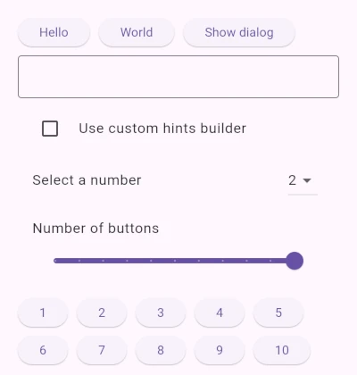

Provides vim inspired navigation to your flutter apps including alphabet hint navigation. Inspired by
browser extensions such as vimium and vimium-c.



Also see [longer demo clip](https://github.com/lea108/flutter_vimium/blob/main/doc/demo_clip_1x.webp?raw=true)
showing of also dialogs and scrolling down with `d`.


## Features

* Random access to user interfaces using keyboard instead of having to use sequential navigation using TAB key.
* hjkl + ud Scroll
* UI package independent with default style (yellow hint overlay) that can be overridden.


## Use cases

* Accessibility
* Keyboard users


## Shortcuts

* `f`: Alphabet hint navigation
* `h`: Scroll left
* `j`: Scroll down
* `k`: Scroll up
* `l`: Scroll left
* `u`: Scroll up full page
* `d`: Scroll down full page
* `i`: Enter insert mode where all input is ignored until you press `Escape`


## Alphabet hint navigation

1. Press `f` to enter alphabet hint navigation
2. Vimium will resolve focusable widgets and place a 1+ letter hint overlay above each widget
3. User types the letters on any hint overlay to activate it
4. Upon activation Vimium will set focus to the target FocusNode and then invoke ActivateIntent on it, causing
   buttons to be clicked etc.


## Getting started

1. Make sure your works using the keyboard. This step is mostly to test that things that are button-like can receive focus and that dialogs correctly trap focus traversal.
2. Install the `flutter_vimium` package
3. Add a builder for your MaterialApp or similar, depending on the UI kit you use.

    ```dart
    MaterialApp(
        builder: (context, child) => Vimium(child: child),
        home: HomeScreen(),
    )
    ```

    It should be added quite far up in the widget tree, but still be able to insert a FocusNode and a Stack to overlay widgets.

    If you instead wrap the material_ui Scaffold of each view, there can be issues
    with Vimium not working in dialogs and other overlays like dropdowns.

4. Start your app and press the `f` key to enter Alphabet hint mode. For scroll shortcuts to work, the primaryFocus need to be within a scroll view. You may need to press `tab` or use `f` to move focus first before you can scroll.


## Configuration:

You can optionally customize the look and behavior of the Vimium experience using these parameters:

* `shortcuts` - provide a custom shortcuts map.
* `hintOverlayBuilder` - customize the hint overlays
* `hintOffset` - customize hint overlay offset
* `hintCharacters` - customize the alphabet. Preferable use letters on the home row of the active keyboard layout.
* `onHintActivate` - provide a custom handler for when a hint is activated that can block or permit the default activation.
* `autofocus` - optionally disable autofocus on the Focus node of Vimium


## Example

The example app demonstrates:
* Custom overlay hints for material_ui using purple Badge widgets.
* Setting hintCharacters to home row of active layout using super_keyboard_layout package.
* Scoped navigation in dialogs and dropdown overlays.
* Text field can be navigated to with hints, but when focused user can type directly without
  having to use insert mode. Use TAB key to leave the text field.
